<div align="center">

# 阿纳克遗迹小助手

**轮次不乱，计分不漏**

《阿纳克遗迹》（Lost Ruins of Arnak）线下对局的多人同步工具：布置清单、每轮流程与轮末整理、终局计分、《失踪的探险队》冒险模式记录一站搞定。支持《探险队长》和《失踪的探险队》两个扩展。

一桌人用手机扫码进同一个房间，所有操作实时同步，无需下载、无需注册。

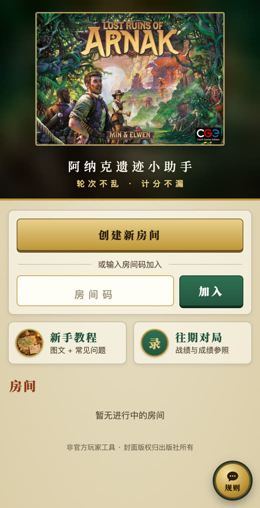

</div>

---

## 做什么、不做什么

开发前先做了社区调研（BGG 2000 多个主题、B 站和贴吧评论、应用商店），原则是：线下用实物更方便的留在线下，需要记录、繁琐、容易漏算的才放到线上。清单和依据见 [docs/调研清单.md](docs/调研清单.md)，完整报告在 [docs/调研/](docs/调研/)。

- **做**：布置清单、每轮开始和轮末整理的提示、谁已跳过、易忘规则、终局分项计分（含单人对手）、同分判定、冒险模式的章节分和进度记录、教程、常见问题、规则助手。
- **不做**：资源计数、手牌和牌库、卡列和月之权杖、研究轨位置、单人对手 AI、在线对战。这些用实物更直观，或者官方已经做了。

## 功能一览

### 准备：扩展、版图、队长，一键生成布置清单

1–4 人。勾选《探险队长》《失踪的探险队》，选鸟之神庙或蛇之神庙一面，以及研究轨（原版、猴之神庙、蜥蜴神庙、瀑布神庙、古树神庙）。可以用探险队长：每人点头像选队长（10 位，附一句话能力和最常见的误解），或者随机分配。座位顺时针排好，起始玩家可以手动指定或随机抽。单人游戏另选对手难度（红色行动板块 0–5 块）。

「看布置清单」按上面的选择列出全部摆放步骤：封锁标记、神庙板块每堆几块、研究奖励放哪些格、每位队长的特殊设置、每人的初始资源。每条都标了规则书页码，点一条勾一条。

<p>
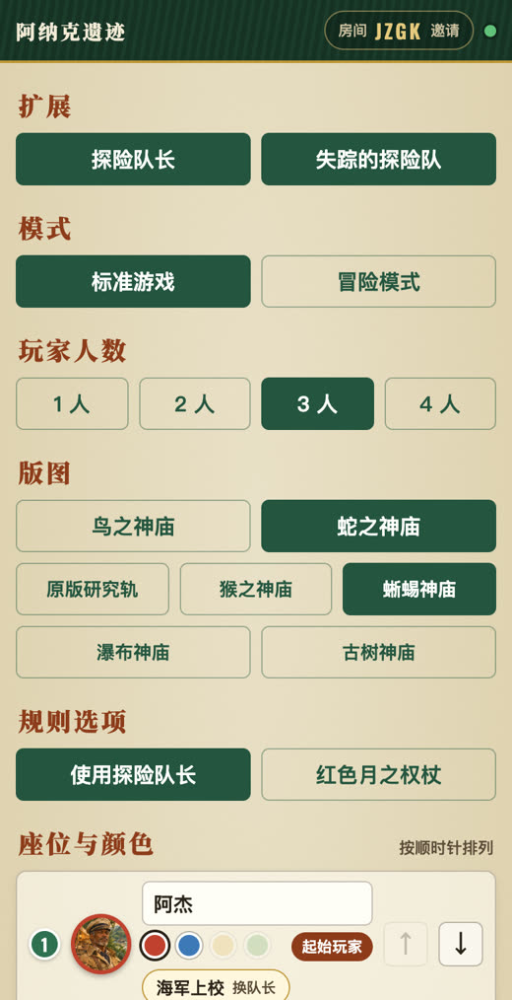
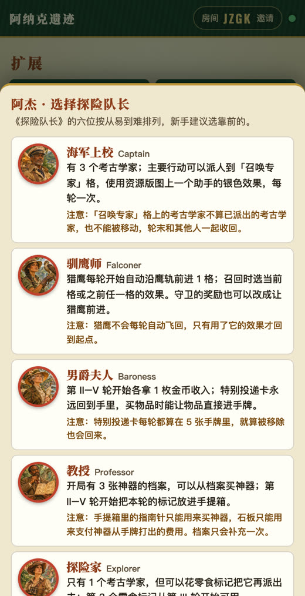
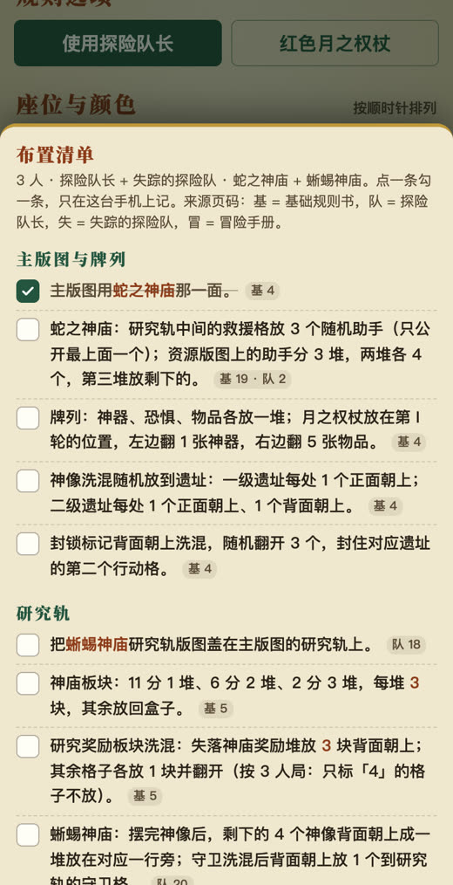
</p>

### 流程：每轮提示，跳过记录，轮末清单

「流程」页显示当前第几轮、行动顺序（起始玩家每轮左移一位）。每轮分三块：

- **本轮开始**：补满 5 张手牌，以及各位队长这一轮要拿的东西（男爵夫人的金币、教授的手提箱标记、驯鹰师的猎鹰、机械师的黄金部件和鲁斯蒂……）。
- **轮流行动**：每人一个「跳过」按钮，谁先谁后都记下来；折叠的「别忘了」列出社区里最常被忘的 8 条规则（花 2 金币换飞机、奖励要立刻用、守卫奖励只能用一次……）。
- **轮末整理**：全员跳过后出现，按规则书顺序列出每一步（先拿恐惧卡再洗牌、移除月之权杖两侧的牌……），随所选扩展和队长增减条目。第 V 轮只收回考古学家，然后计分。

点错可以撤销，断线重连自动追上进度。

<p>
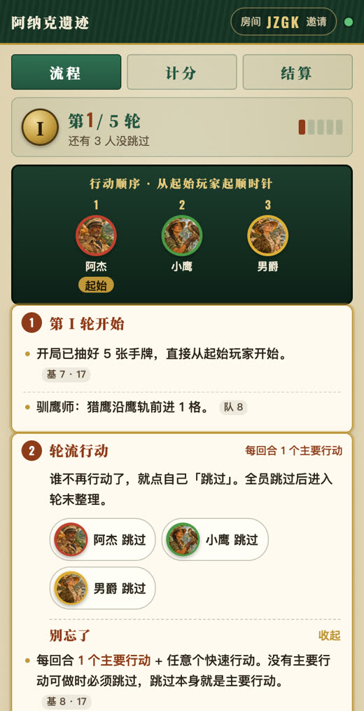
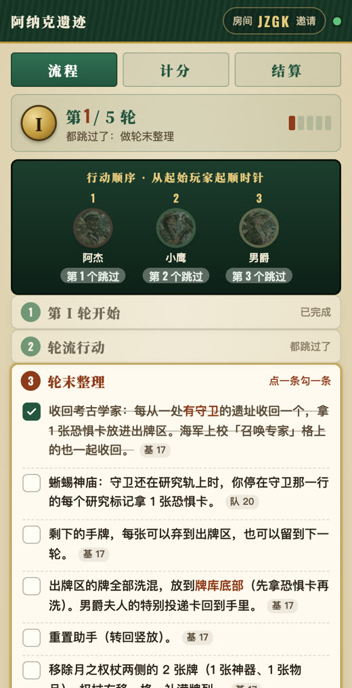
</p>

### 计分：每人在自己手机上填，带防错提示

「我的计分」：每人选好自己是谁，只填自己的分数。研究轨、神庙板块、物品和神器逐项输入（神庙板块有 11 / 6 / 2 快捷键），神像、守卫、恐惧卡填个数，自动乘分。每项旁边写清怎么算，常见错误单独提示：神像放进槽也算分、牌库里的卡也算分、神庙板块只有 11 / 6 / 2 三种、神秘人祭典牌堆里的恐惧卡不扣分、教授档案里的神器不算分。

「全桌总览」：一张竖向计分表，没手机的玩家可以由别人代填。单人和冒险模式另有「对手」一页，按单人规则计分（重复的神像每个 2 分）。

<p>
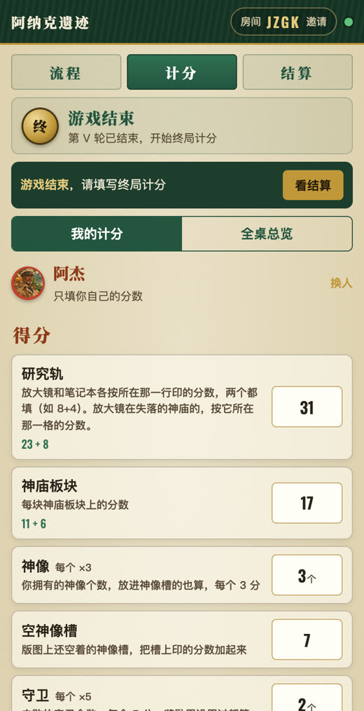
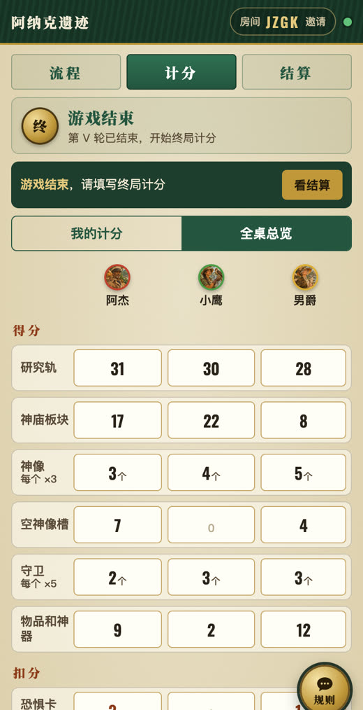
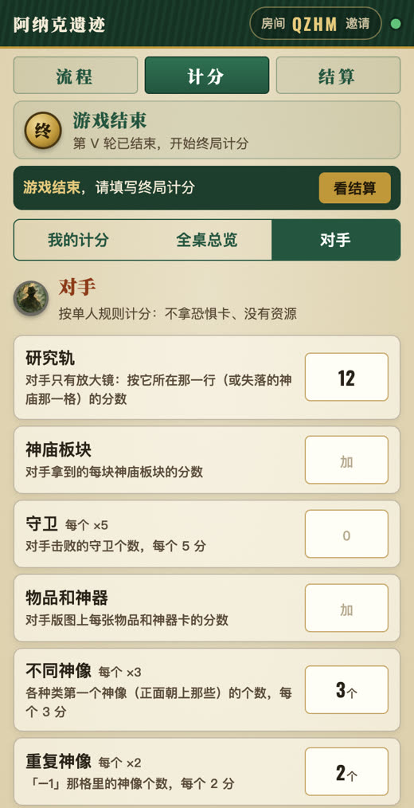
</p>

### 结算：排名、同分判定、成就、长图、打分

自动排名。同分时按规则书判定：先到失落的神庙的赢（点一下谁先到），都没到就比研究轨分数。展示得分构成和 9 种成就，可以改玩家名、一键存结算长图，最后给这款游戏打个分（提交到桌游小助手首页）。

<p>
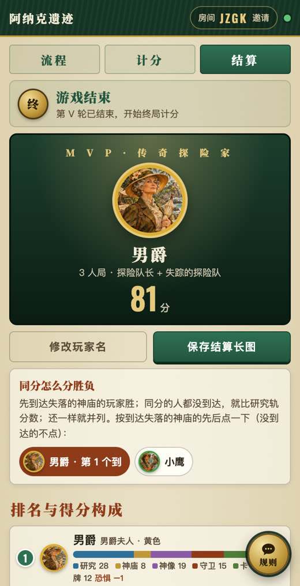
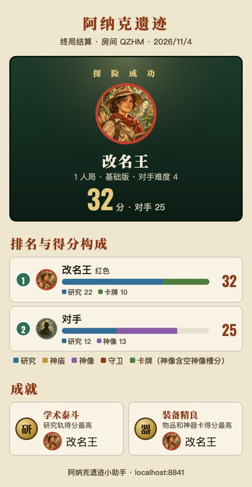
</p>

### 冒险模式（《失踪的探险队》）

单人或双人合作，6 章。每章正常走流程和计分，「本章」页自动算章节分：本方分数（双人相加除以 2，保留半分）减去对手分数，接受失败记 −10。记录胜负、成就数和剧情点编号，进度存在房间里，下次进同一个房间码接着玩。下一章的布置清单会提醒剧情点卡放牌库底、上一章失败时的惩罚在冒险手册哪一页。六章打完显示冒险总分（双人向上取整）。

不收录任何剧情文本和章节规则原文，不自动执行对手 AI，也不判定章节目标。这些看冒险手册和实物。

<p>
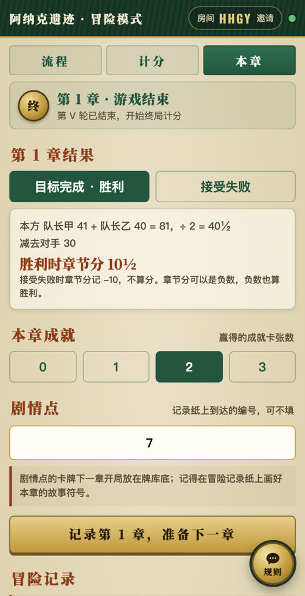
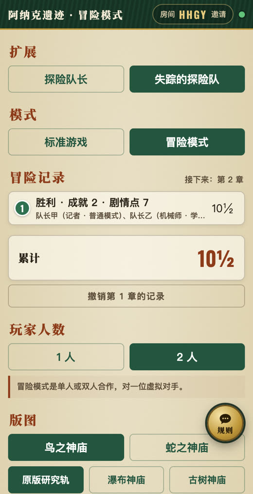
</p>

### 往期对局

每局标准游戏结束自动存档，可按玩家名、颜色、队长或房间码搜索。上方的「成绩参照」按人数 × 扩展列出平均分、冠军平均分和最高分；搜索玩家名时再列出这个人的最高分和平均分。冒险模式不计入。

### 新手教程与常见问题

16 节图文讲解，加上 39 条常见问题（含易混卡牌和设计者在 BGG 上的裁定），每条附规则书页码或 BGG 链接。插图为原创绘制。

<p>
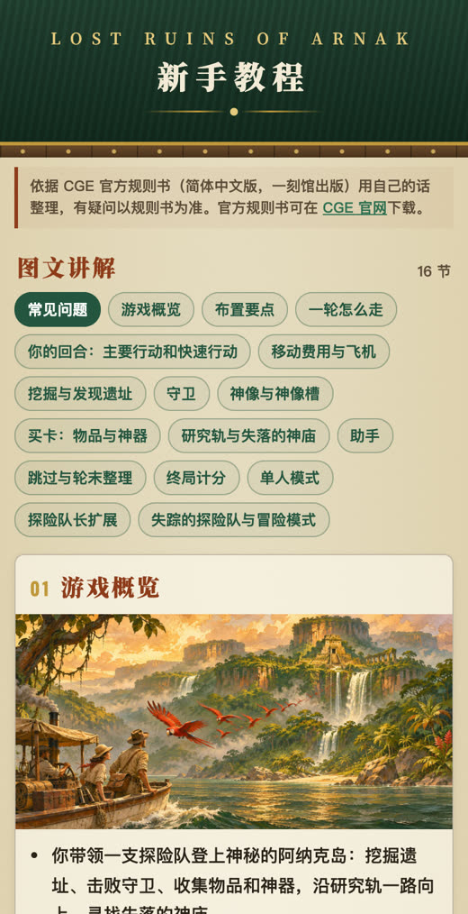

</p>

### 规则助手

每个页面右下角都有「规则」按钮，用中文问规则。只依据本站的讲解稿和常见问题作答，资料里没有的不会乱编，也不剧透冒险模式。

模型和匹兹堡助手相同：DeepSeek V4.1 Flash（`deepseek-flash`）→ Cloudflare Workers AI 上的 Qwen3.8 27B（`@cf/qwen/qwen3.8-27b`）→ DeepSeek V4 Pro（`deepseek-v4-pro`）。每个模型 9 秒内必须开始回答，中途停顿超过 8 秒就换下一个从头回答；页面上不显示是哪个模型答的。DeepSeek 不通时，接下来一小时直接先用 Qwen。这个 Cloudflare 账号免费版的定时任务（Cron Trigger）已经用满，所以本站不自己检查，而是读匹兹堡助手每小时检查后写进 KV 的结果：`wrangler.jsonc` 里 `CHAT_STATE` 绑定的就是匹兹堡的 KV，本站只读不写。

<p>
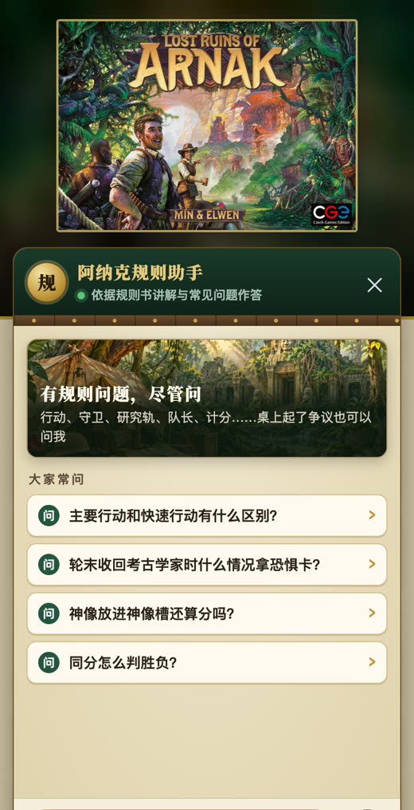
</p>

---

## 技术实现

纯前端页面 + Cloudflare Workers，没有构建步骤，没有框架。

| 部分 | 说明 |
|---|---|
| `public/` | 页面：`index.html`、`app.js`、`style.css`、`img/`、教程页 `guide.html`、往期对局 `history.html` |
| `public/logic.js` | 规则与状态逻辑（轮次、跳过、计分、同分、冒险章节分），页面和服务端共用，服务端用 `reduce()` 权威判定 |
| `public/steps.js` | 布置清单、每轮开始、轮末整理、「别忘了」和队长说明，每条带规则书页码 |
| `src/worker.js` | Cloudflare Worker：建房接口；`Room`（每个房间一个 Durable Object，WebSocket 实时同步）；`Lobby`（首页房间列表）；`Archive`（往期对局和成绩参照）；`/api/chat` 规则助手（流式转发、备用模型切换、按 IP 限流，密钥只在服务端） |
| `public/vendor/` | [html2canvas](https://github.com/niklasvh/html2canvas) 1.4.1（MIT），生成结算长图 |
| `tools/` | 教程页生成脚本、讲解稿、常见问题数据 |
| `tests/` | 规则单元测试 + Playwright 多手机端到端测试 |

## 本地开发与部署

图片缓存 7 天，部署时若替换同名图片，用户最多需要等待 7 天才能看到新图。

需要 Node.js 和 [Wrangler](https://developers.cloudflare.com/workers/wrangler/)。

```bash
wrangler dev --port 8841     # 本地运行，打开 http://localhost:8841
wrangler deploy              # 部署到你自己的 Cloudflare 账号
```

自己部署时：
- **域名**：在 `wrangler.jsonc` 里加上自己的 `routes`（自定义域名）。
- **DeepSeek 状态**：`CHAT_STATE` 绑定的是匹兹堡助手的 KV。自己部署时改成你自己的 KV，再加一个每小时检查 DeepSeek 的定时任务（参考匹兹堡助手的 `checkDeepSeek`）；不改也能用，只是少了「不通时先用 Qwen」这一步。
- **规则助手**（可选）：运行 `wrangler secret put DEEPSEEK_API_KEY --name <worker 名>` 填入 DeepSeek API 密钥；不配置时助手会提示「还没有配置好」。

重新生成教程页：

```bash
python3 tools/build_guide.py tools/讲解稿.md public/guide.html tools/faq.json
```

## 测试

需要本机安装 Chrome，以及 `npm i playwright-core`。

```bash
node tests/test_logic.mjs                                                    # 规则单元测试（不需要服务器）
node tests/test_room.mjs    http://localhost:8841/ ./shots                    # 双手机 3 人局：两个扩展 + 队长，5 轮流程、计分、同分判定
node tests/test_room2.mjs   http://localhost:8841/ ./shots                    # 单人对手、冒险模式两章、小屏、改名、长图、断线重连
node tests/test_history.mjs http://localhost:8841/ ./shots --many-rooms       # 往期对局存档、搜索、成绩参照；房间多时首页按钮仍在首屏
node tests/test_review.mjs  http://localhost:8841/ ./shots                    # 结算页评价卡（总入口接口用 page.route 拦截，不写线上数据）
node tests/test_chat.mjs    http://localhost:8841/ ./shots --no-key           # 规则助手界面（wrangler dev 不带密钥）
node tests/test_chat.mjs    http://localhost:8841/ ./shots --fake-key         # 请求校验、上游出错、限流
node tests/test_chat.mjs    http://localhost:8841/ ./shots --mock-upstream    # 备用模型切换
node tests/test_history.mjs https://你的域名/ ./shots --live                  # 线上冒烟：打完一局再撤销，不留记录
node tests/test_chat.mjs    https://你的域名/ ./shots --live                  # 规则助手线上实问一次
```

`--fake-key` 和 `--mock-upstream` 需要 `wrangler dev --port 8841 --var DEEPSEEK_API_KEY:fake --var DEEPSEEK_BASE:http://127.0.0.1:8842 --var CHAT_CF_MODEL:@cf/none/missing`（模拟上游在 8842 端口；`@cf/none/missing` 让本地测试不消耗共享的 Workers AI 免费额度）。两者连着跑会触发每分钟 8 次的限流，中间隔一分钟。想在本地模拟「DeepSeek 不通」：`wrangler kv key put deepseek-down 1 --binding CHAT_STATE --local`（只写本地模拟数据，不碰线上）。

打完整局的测试会在往期对局里留下记录，所以请对本地 `wrangler dev` 运行；线上只跑 `--live`。

## 声明

- 本项目是非官方的玩家工具，不提供游戏本体。线下对局仍需实体《阿纳克遗迹》。
- 规则依据 CGE 官方规则书（简体中文版由一刻馆出版）：基础版、《探险队长》、《失踪的探险队》和冒险手册 v1.02，页码以简体中文版为准；常见问题由规则书和设计者在 BGG 上的回答整理，并非官方 FAQ。来源和待核实的地方见 [docs/规则来源.md](docs/规则来源.md)。
- 游戏名称、规则和首页的游戏盒封面版权归出版社（Czech Games Edition）所有。其他插图（队长头像、教程配图等）为原创绘制。
- 代码以 [MIT](LICENSE) 许可开源。
